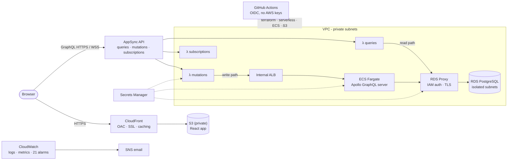

# GraphQL Serverless Architecture on AWS

A React task board backed by a **serverless GraphQL API** on AWS: AppSync with TypeScript Lambda
resolvers, a **private Apollo GraphQL server on ECS Fargate**, and **RDS PostgreSQL** in private
subnets. It's deployed by **GitHub Actions** with tests, smoke checks and automatic rollback.


## Architecture



See [docs/architecture.md](docs/architecture.md) for the full diagram, request flows and design decisions.

## How it works

| Operation | Path |
|---|---|
| **Query** | Browser → AppSync → `queries` Lambda → RDS Proxy → RDS |
| **Mutation** | Browser → AppSync → `mutations` Lambda → internal ALB → **Fargate GraphQL server** → RDS Proxy → RDS |
| **Subscription** | AppSync pushes over WebSocket whenever a mutation completes (`@aws_subscribe`). The `subscriptions` Lambda validates each subscribe request. |

## Tech stack

| Layer | Technology |
|---|---|
| Frontend | React 19, Vite, TypeScript. S3 + CloudFront (OAC, HTTP/3, security headers, ACM) |
| API | AWS AppSync (GraphQL, real-time WebSockets) |
| Lambdas | TypeScript, Node.js 22, arm64. **Serverless Framework** + esbuild |
| Private server | Apollo Server 5 + Express 5 on **ECS Fargate** (arm64, Fargate Spot), internal ALB |
| Database | **RDS PostgreSQL 16** + RDS Proxy, IAM database auth, isolated subnets |
| IaC | **Terraform** (infrastructure) + Serverless Framework (functions), joined through SSM Parameter Store |
| CI/CD | **GitHub Actions** with OIDC → IAM role |
| Observability | CloudWatch Logs/Metrics/Alarms/Dashboard, Container Insights, X-Ray, SNS |
| Secrets | AWS Secrets Manager (RDS-managed master secret, internal API token) |

## Quick start

```bash
# 1. One-time bootstrap: Terraform state bucket + GitHub OIDC deploy role
cd infrastructure/bootstrap && terraform init && terraform apply

# 2. In GitHub: set variables AWS_DEPLOY_ROLE_ARN, TF_STATE_BUCKET, AWS_REGION and secret ALERT_EMAIL

# 3. Push to main - the pipeline provisions and deploys everything
git push origin main
```

Full guide: [docs/deployment.md](docs/deployment.md)

**Local development:** `docker compose up --build` starts PostgreSQL and the GraphQL server on `:4000`.

## Documentation

| Topic | Document |
|---|---|
| Architecture diagram, flows, design decisions | [docs/architecture.md](docs/architecture.md) |
| How to deploy and test | [docs/deployment.md](docs/deployment.md) |
| IAM policies and security configuration | [docs/iam-security.md](docs/iam-security.md) |
| CI/CD pipeline steps and configuration | [docs/cicd.md](docs/cicd.md) |
| Database setup and security best practices | [docs/database.md](docs/database.md) |
| Monitoring and alerts | [docs/monitoring.md](docs/monitoring.md) |
| Scaling strategy | [docs/scaling.md](docs/scaling.md) |
| Rollback strategy | [docs/rollback.md](docs/rollback.md) |

## Repository structure

```
├── backend/
│   ├── lambdas/              # AppSync resolver Lambdas + migrations (serverless.yml)
│   └── graphql-server/       # Private Apollo GraphQL server (Dockerfile → ECS Fargate)
├── frontend/                 # React + Vite app
├── database/migrations/      # SQL migrations (AWS migrate Lambda + local docker-compose)
├── infrastructure/
│   ├── bootstrap/            # Terraform state bucket + GitHub OIDC role (run once)
│   ├── modules/              # vpc · rds · ecs · frontend · secrets · monitoring
│   └── environments/prod/    # Composition, security groups, SSM outputs
├── scripts/                  # Smoke test, rollback helpers, frontend publish
├── docs/                     # Documentation
└── .github/workflows/        # ci.yml · deploy.yml · rollback.yml
```

## Key design decisions

1. **AppSync for the public API.** It gives managed WebSocket subscriptions, which plain Lambda
   can't hold open, with Lambda resolvers for the business logic.
2. **Read/write split.** Reads go straight from Lambda to RDS (fewest hops). Writes go through the
   private Fargate server, which owns the write rules.
3. **RDS Proxy + IAM auth.** It stops Lambda bursts from exhausting DB connections, and there are no
   database passwords in any app, environment variable or pipeline.
4. **No public path to the backend.** The Fargate server sits behind an internal ALB, and RDS is in
   subnets with no internet route. Access is controlled by SG-to-SG rules.
5. **OIDC instead of AWS keys** in GitHub, and immutable SHA-tagged images for exact rollbacks.
6. **Cost-optimised defaults.** Graviton, Fargate Spot, a single NAT, CloudFront `PriceClass_100`,
   and `db.t4g.micro`. Each one is a single variable to switch for production HA.
