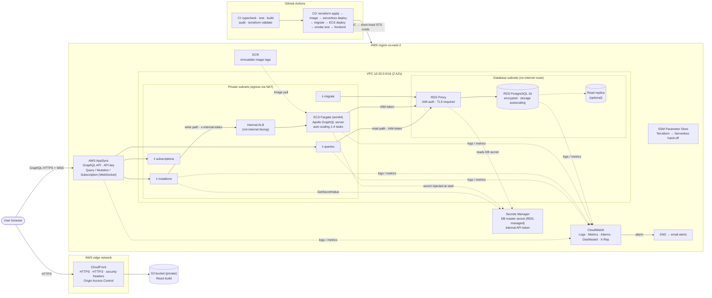
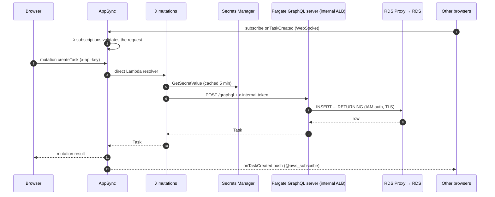

# Architecture

## System diagram



## Request flows

### Read (query)

```
Browser ──HTTPS──▶ AppSync ──▶ λ queries ──IAM token/TLS──▶ RDS Proxy ──▶ RDS
```

Reads skip the Fargate server. This is the hot path, so it has the fewest hops. The `queries` Lambda
uses one pooled connection per container, and RDS Proxy multiplexes thousands of Lambda containers
onto a small number of real database connections.

### Write (mutation) + real-time push (subscription)



## Why each piece is there

| Requirement | Implementation | Reasoning |
|---|---|---|
| React frontend, cost-optimised, caching, access control, SSL | S3 (private) + CloudFront with OAC, `PriceClass_100`, two cache policies, a security-headers policy, and an ACM cert or the default `*.cloudfront.net` cert | No servers to run, so it costs pennies at low traffic. Content-hashed assets are cached for 1 year and `index.html` revalidates within 60 s. The bucket can only be read by this one distribution. |
| Several Lambdas in TypeScript for queries, mutations and subscriptions | `queries`, `mutations`, `subscriptions` and `migrate` Lambdas, bundled with esbuild, Node 22, arm64 | Separate functions mean separate IAM roles, alarms and scaling. Graviton (arm64) costs about 20% less. |
| Serverless Framework | `backend/lambdas/serverless.yml` (v3) with the AppSync, esbuild and per-function IAM plugins | Rollback is built in (`serverless rollback`), and CI doesn't need a vendor login. |
| Subscriptions | AppSync `@aws_subscribe` over managed WebSockets. The `subscriptions` Lambda validates each subscribe request. | Plain API Gateway + Lambda can't keep WebSocket connections open. AppSync handles connection state and fan-out without any servers. |
| Private GraphQL server on Fargate | Apollo Server 5 on ECS Fargate in private subnets, behind an **internal** ALB | Not reachable from the internet at all. The security group only admits the Lambda SG, and every request also needs a shared token from Secrets Manager. |
| RDS in a private subnet | PostgreSQL 16 in isolated database subnets with no NAT and no IGW route, reachable only through RDS Proxy | The instance accepts traffic only from the proxy's security group. TLS is enforced (`rds.force_ssl=1`). |
| Lambda ↔ GraphQL server ↔ RDS | Read path: Lambda → RDS. Write path: Lambda → Fargate → RDS. | Both integrations the brief asks for, and each path has a reason: reads are latency-sensitive, writes go through one service that owns the business rules. |
| Secrets | The RDS-managed master secret, plus an internal token in Secrets Manager. Apps connect to the DB with **IAM tokens**, not passwords. | No database password exists in any app config, environment variable, image, Terraform output or GitHub secret. |
| CI/CD | GitHub Actions with OIDC (no stored AWS keys), CI reused as the first deploy stage | See [cicd.md](cicd.md) |
| Monitoring | 21 CloudWatch alarms that email through SNS, one dashboard, Container Insights, X-Ray, JSON logs | See [monitoring.md](monitoring.md) |
| Scaling | Lambda (automatic, protected by RDS Proxy), ECS target tracking (CPU, memory, requests) with Fargate Spot, RDS storage autoscaling plus an optional replica | See [scaling.md](scaling.md) |
| Rollback | Serverless rollback to the previous deployment timestamp, the ECS circuit breaker plus revert to the previous task definition, frontend re-publish of the last good release | See [rollback.md](rollback.md) |

## Infrastructure-as-code split

| Tool | Owns | Why |
|---|---|---|
| **Terraform** (`infrastructure/`) | VPC, subnets, NAT, security groups, RDS, RDS Proxy, ECS, ALB, ECR, S3, CloudFront, Secrets Manager, SNS, alarms, dashboard, GitHub OIDC role | Long-lived, stateful infrastructure. Plan/apply gives a reviewable diff. |
| **Serverless Framework** (`backend/lambdas/`) | Lambdas, AppSync API, resolvers, per-function IAM roles, Lambda/AppSync alarms | Fast application deploys with built-in versioned rollback. |
| **SSM Parameter Store** | The interface between them | Terraform publishes IDs, endpoints and ARNs under `/graphql-app/prod/*`, and `serverless.yml` reads them with `${ssm:...}`. Neither tool hard-codes the other's values. |

## Repository layout

```
├── backend/
│   ├── lambdas/            AppSync resolvers + migrations (Serverless Framework)
│   └── graphql-server/     Private Apollo server (Docker → ECR → ECS Fargate)
├── frontend/               React + Vite SPA
├── database/migrations/    SQL (used by the migrate Lambda AND docker-compose)
├── infrastructure/
│   ├── bootstrap/          State bucket + GitHub OIDC deploy role (run once)
│   ├── modules/            vpc, rds, ecs, frontend, secrets, monitoring
│   └── environments/prod/  Composition, security groups, SSM hand-off
├── scripts/                smoke test, rollback helpers, frontend publish
└── .github/workflows/      ci.yml, deploy.yml, rollback.yml
```
