# CI/CD pipeline (GitHub Actions)

## Workflows

| File | Trigger | Purpose |
|---|---|---|
| `.github/workflows/ci.yml` | Pull requests, pushes to non-`main` branches, and called by `deploy.yml` | Quality gate: no AWS access needed |
| `.github/workflows/deploy.yml` | Push to `main`, manual dispatch | Full production deploy with automatic rollback |
| `.github/workflows/rollback.yml` | Manual dispatch | Roll any component back to a chosen earlier version |
| `.github/dependabot.yml` | Weekly | Dependency update PRs (npm, Docker, Terraform, Actions) |

## Deploy pipeline

```mermaid
flowchart LR
    push(["push to main"]) --> ci

    subgraph ci["1 · CI (reused ci.yml)"]
        direction TB
        l["Lambdas<br/>typecheck · test · bundle · audit"]
        g["GraphQL server<br/>typecheck · test · build · audit · docker build"]
        f["Frontend<br/>test · build · audit"]
        t["Terraform<br/>fmt · validate"]
        s["shellcheck"]
    end

    ci --> infra["2 · Terraform plan + apply<br/>(environment: production<br/>optional approval gate)"]
    infra --> img["3 · Build arm64 image<br/>tag = git SHA → ECR"]
    img --> be

    subgraph be["4 · Backend"]
        direction TB
        rec1["record last-good versions"] --> sls["serverless deploy"] --> mig["invoke migrate"] --> ecs["ECS rolling deploy<br/>wait for stability"] --> ver["verify new revision running"] --> smoke["smoke test<br/>(read + write paths)"]
    end

    be --> fe

    subgraph fe["5 · Frontend"]
        direction TB
        rec2["record last-good release"] --> build["build with AppSync config"] --> arch["archive release to S3"] --> pub["publish + invalidate"] --> smoke2["smoke test<br/>HTTPS · headers · assets"] --> mark["mark LAST_GOOD"]
    end

    smoke -. "fail" .-> rb1["auto-rollback<br/>serverless rollback + ECS revert"]
    smoke2 -. "fail" .-> rb2["auto-rollback<br/>republish previous release"]
```

## Stages in detail

### 1. CI: testing and validation before anything touches production

| Job | Checks |
|---|---|
| Lambdas | `tsc --noEmit`, 13 Vitest unit tests (query/mutation/subscription handlers, migrations, validation), esbuild bundles every handler, `npm audit --omit=dev --audit-level=high` |
| GraphQL server | Typecheck, 11 tests (resolvers via `executeOperation`, auth, config, error masking), `tsc` build, audit, `docker build` |
| Frontend | 4 reducer tests, `tsc` + `vite build`, audit |
| Terraform | `terraform fmt -check`, `terraform validate` for both stacks (providers pinned by `.terraform.lock.hcl`) |
| Scripts | `shellcheck` |

Any failure stops the pipeline before the infrastructure stage.

### 2. Infrastructure

`terraform plan -out=tfplan` then `terraform apply tfplan`, so exactly the reviewed plan is applied.
This job runs in the `production` **environment**. Adding *required reviewers* to that environment
makes it a manual approval gate.

### 3. Image

Built on a native `ubuntu-24.04-arm` runner, so there's no QEMU emulation and builds are fast.
Tagged with the **git SHA**. ECR tags are **immutable**, so a SHA always means the same bytes, which
makes rollbacks exact. Re-running a workflow skips the build if that SHA already exists.

### 4. Backend

1. **Record rollback targets**: the current ECS task definition ARN and the latest Serverless deployment timestamp.
2. **`serverless deploy`**: one CloudFormation stack update. If CloudFormation fails, it rolls the stack back by itself.
3. **`serverless invoke -f migrate`**: idempotent SQL migrations inside the VPC, with an advisory lock against concurrent runs.
4. **ECS deploy**: render the task definition with the new image, then a rolling update (min 100% / max 200% healthy) and wait for stability.
5. **Verify revision**: guards against the ECS circuit breaker silently rolling back while the deploy action still reports "stable".
6. **Smoke test**: `scripts/smoke-test.sh` through the public API.
7. **On any failure**: `serverless rollback --timestamp <previous>` and `aws ecs update-service --task-definition <previous>`.

### 5. Frontend

The build gets the **live** AppSync URL and key from the deployed API (`scripts/appsync-config.sh`).
Nothing is hard-coded. Each release is archived to `s3://…-releases-…/frontend/releases/<sha>/`.
Assets go up first with `immutable` caching, then `index.html` with `no-cache`, then a CloudFront
invalidation of `/` and `/index.html` only (cheap, because hashed assets never need invalidating).

## Configuration and secrets in the pipeline

| Name | Kind | Purpose |
|---|---|---|
| `AWS_DEPLOY_ROLE_ARN` | variable | Role assumed with OIDC (`id-token: write`) |
| `TF_STATE_BUCKET` | variable | Terraform backend |
| `AWS_REGION` | variable | Defaults to `us-east-2` |
| `DOMAIN_NAME` | variable | Optional custom domain |
| `ALERT_EMAIL` | **secret** | SNS alarm subscription |

Everything else (subnets, security groups, endpoints, secret ARNs, bucket names) is read **at
runtime from SSM Parameter Store**, where Terraform published it. Secret *values* (the internal
token, the DB password) are never in GitHub. They live in Secrets Manager and are fetched by the
workloads' own IAM roles.

## Safety properties

- `concurrency: deploy-prod`, `cancel-in-progress: false`: two deploys never overlap, and a deploy is never killed half-way. The manual rollback workflow shares the same lock.
- `permissions: contents: read` by default. `id-token: write` only on jobs that need AWS.
- Jobs are ordered with `needs:`, so the frontend never ships against a backend that failed its smoke test.
- Action versions are pinned to major tags, and Dependabot keeps them current.
